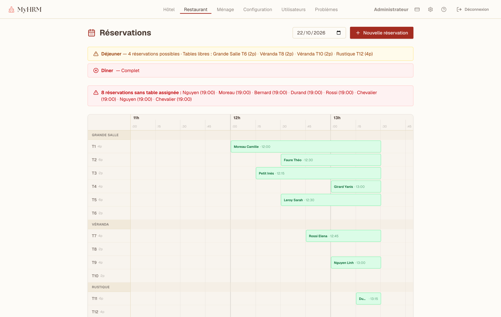
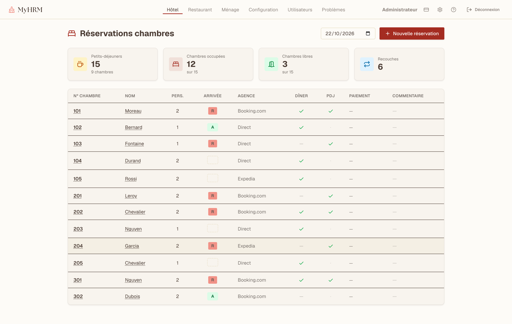

# Tristan Lacombe

**Développeur Full-Stack · Docteur en Sciences de la Terre**

Je conçois des applications web qui rendent exploitables des données scientifiques et
géographiques — du modèle de données jusqu'à l'interface, en passant par les tests et le déploiement.

Actuellement **développeur full-stack & testeur logiciel en alternance chez MSInsight** (dispositif
médical de diagnostic in vitro, ISO 13485 / IEC 62304). Je recherche un poste à l'interface
**logiciel · données · géosciences**, en agglomération lyonnaise.

---

## Ce que je fais

- **Des applications métier complètes** — authentification, rôles et permissions, migrations de
  base, API documentées, interfaces réactives. Pas de prototype jetable : des produits qui tournent.
- **Du calcul scientifique derrière une interface utilisable** — j'enveloppe des bibliothèques Python
  de pétrologie et de géochimie dans des services web, pour que des géologues les utilisent sans
  écrire une ligne de code.
- **Des tests et une chaîne CI/CD** — tests unitaires, d'intégration et end-to-end, lint, typecheck
  et audits de sécurité bloquants avant chaque déploiement.
- **De l'hébergement que j'administre moi-même** — VPS Linux, Docker Compose, Nginx, runners
  GitHub Actions auto-hébergés, durcissement SSH.

---

## Stack

**Front**

      

**Back**

      

**Qualité**

       

**Infra**

     

**Données & SIG**

       

**Méthodes** — Agile / Scrum · développement assisté par IA (Claude Code) · environnement réglementé (ISO 13485, IEC 62304)

---

## Projets

### Petro-Geoch Online Tool (PGeoOT) · privé

Plateforme web modulaire de pétrologie et de géochimie. Le premier module expose la bibliothèque
scientifique Python [Thermobar](https://github.com/PennyWieser/Thermobar) (thermobarométrie,
hygrométrie) derrière une interface sans code : import de données, calcul de la norme CIPW,
formules structurales, graphiques interactifs, export Excel. Inscription sur code d'invitation,
administration des comptes.

**Monorepo Turborepo / npm workspaces, trois applications :**
- `web` — React, Vite, Tailwind, TanStack Query, Plotly, ExcelJS
- `api` — NestJS, TypeORM, PostgreSQL, JWT/Passport, Helmet, rate limiting, migrations versionnées
- `calc-svc` — Python 3.12, FastAPI, Thermobar, pyrolite, NumPy/pandas (géré avec `uv`)

**Ce dont je suis le plus satisfait :** la CI exécute lint, typecheck, tests Node, ruff et pytest,
plus `audit-ci` et `pip-audit` en barrières bloquantes ; le déploiement est déclenché par tag sur un
runner auto-hébergé et ne part qu'avec une CI verte. Le dépôt documente un audit de sécurité et un
audit RGPD.

  

  

### My-HRM · privé

Application de gestion pour hôtel-restaurant : réservations de chambres (arrivées, départs,
recouches, petits-déjeuners), planning des tables du restaurant par salle et par service, suivi du
ménage, gestion du personnel et des rôles, agences partenaires, abonnement Stripe.

L'application fait respecter les règles du métier plutôt que de les laisser passer : jours de
fermeture, créneaux de service, capacité des chambres selon les lits — chaque création est validée
côté serveur.

**Stack :** NestJS, TypeORM, PostgreSQL, Swagger, Stripe · React, Vite, Tailwind, Radix UI,
Zustand, TanStack Query, PWA · monorepo npm workspaces, Docker Compose, déploiement sur VPS par SSH.
Tests Jest + Supertest côté API (unitaires, contrôleurs, e2e) et Vitest côté interface.
Documentation technique : diagramme de classes, modèle de données, architecture de déploiement,
plans de test.

  

  

### [Unofficial GERM API](https://github.com/LacombeTr/volcapi) · public

API REST qui expose au format JSON les données du **GERM** (Geochemical Earth Reference Model),
jusqu'ici disponibles uniquement sous forme de tableaux HTML — pour les rendre exploitables par
des applications web et des scripts d'analyse.

**Stack :** TypeScript, Express, Drizzle ORM, PostgreSQL, collecte avec Cheerio, documentation
Swagger, tests Jest, conteneurisation Docker.

---

## Parcours & publications

**Docteur en Sciences de la Terre** (Université Clermont Auvergne, 2020–2023) — Laboratoire Magmas
et Volcans. Thèse : *Volcanisme basaltique et phonolitique de Petite-Terre (Mayotte)*, en
collaboration avec l'IPGP, l'Université Lyon 1 et l'OVSG. Quatre campagnes de terrain à Mayotte,
cartographie géomorphologique sous QGIS, plus de 500 échantillons analysés à la microsonde
électronique, traitement des données en Python.

**Développeur Full-Stack — niveau 6** (IT-Akademy, Lyon, 2024–2026, en alternance).

Publications à comité de lecture :

- Lacombe T., Gurioli L., Di Muro A., Médard E., *et al.* (2024) — Late Quaternary explosive
  phonolitic volcanism of Petite-Terre (Mayotte, Western Indian Ocean). *Bulletin of Volcanology*.
  [10.1007/s00445-023-01697-2](https://doi.org/10.1007/s00445-023-01697-2)
- Michaud-Dubuy A., Komorowski J.-C., Lacombe T., Gurioli L. (2024) — Tephra fallout hazard
  assessment for a hydrovolcanic eruptive scenario in Mayotte. *Scientific Reports*.
  [10.1038/s41598-024-83266-x](https://doi.org/10.1038/s41598-024-83266-x)
- Thivet S., Hess K.-U., Dingwell D. B., *et al.*, Lacombe T., Komorowski J.-C. (2023) — Volatiles
  of the active Mayotte volcanic chain: STA & EGA-MS analysis of volcanic products.
  *Chemical Geology*. [10.1016/j.chemgeo.2022.121297](https://doi.org/10.1016/j.chemgeo.2022.121297)

---

## Contact

- **LinkedIn** — [tristan-lacombe](https://www.linkedin.com/in/tristan-lacombe-734168139/)
- **Portfolio** — [lacombet.fr](https://lacombet.fr)
- **Email** — tlacombevulca@outlook.fr

Le code des projets privés peut être présenté sur demande, démonstration à l'appui.

---

<b>🇬🇧 English version</b>

 

**Full-Stack Developer · PhD in Earth Sciences**

I build web applications that make scientific and geospatial data usable — from the data model to
the interface, including tests and deployment.

Currently a **full-stack developer & software tester apprentice at MSInsight** (in-vitro diagnostic
medical device, ISO 13485 / IEC 62304). I am looking for a role at the intersection of
**software, data and geosciences**, in the Lyon area.

### What I do

- **Complete business applications** — authentication, roles and permissions, database migrations,
  documented APIs, reactive interfaces. Not throwaway prototypes: products that actually run.
- **Scientific computing behind a usable interface** — I wrap Python petrology and geochemistry
  libraries in web services so geologists can use them without writing a line of code.
- **Tests and a real CI/CD pipeline** — unit, integration and end-to-end tests, linting, type
  checking and blocking security audits before every deployment.
- **Infrastructure I run myself** — Linux VPS, Docker Compose, Nginx, self-hosted GitHub Actions
  runners, SSH hardening.

### Stack

**Front**

      

**Back**

      

**Quality**

       

**Infra**

     

**Data & GIS**

       

**Practices** — Agile / Scrum · AI-assisted development (Claude Code) · regulated environments (ISO 13485, IEC 62304)

### Projects

**Petro-Geoch Online Tool (PGeoOT)** · private — Modular web platform for petrology and
geochemistry. Its first module exposes the Python library
[Thermobar](https://github.com/PennyWieser/Thermobar) (thermobarometry, hygrometry) through a
no-code interface: data import, CIPW norm, structural formulae, interactive charts, Excel export.
Turborepo monorepo with three apps — React/Vite/Tailwind front end, NestJS + TypeORM + PostgreSQL
API, and a Python 3.12 FastAPI calculation service. CI runs lint, type checking, Node tests, ruff
and pytest, plus `audit-ci` and `pip-audit` as blocking gates; tag-triggered deployment to a
self-hosted runner. The repository documents a security audit and a GDPR audit.

**My-HRM** · private — Hotel and restaurant management app: room bookings (arrivals, departures,
stayovers, breakfasts), restaurant table planning by room and service, housekeeping tracking, staff
and roles, partner agencies, Stripe subscription. Business rules are enforced server-side rather
than left to the UI: closing days, service time windows, room capacity derived from beds. NestJS +
TypeORM + PostgreSQL + Swagger + Stripe; React + Vite + Tailwind + Radix UI + Zustand + PWA.
Jest/Supertest API tests (unit, controller, e2e) and Vitest on the front end. Docker Compose, SSH
deployment to a VPS.

**[Unofficial GERM API](https://github.com/LacombeTr/volcapi)** · public — REST API serving the
**GERM** (Geochemical Earth Reference Model) dataset as JSON — previously available only as HTML
tables — so web apps and analysis scripts can consume it. TypeScript, Express, Drizzle ORM,
PostgreSQL, Cheerio ingestion, Swagger docs, Jest tests, Docker.

### Background & publications

**PhD in Earth Sciences** (Université Clermont Auvergne, 2020–2023) — Laboratoire Magmas et Volcans.
Thesis: *Basaltic and phonolitic volcanism of Petite-Terre (Mayotte)*, in collaboration with IPGP,
Université Lyon 1 and OVSG. Four field campaigns in Mayotte, geomorphological mapping in QGIS, over
500 samples analysed by electron microprobe, data processing in Python.

**Full-Stack Developer — EQF level 6** (IT-Akademy, Lyon, 2024–2026, apprenticeship).

Peer-reviewed publications:

- Lacombe T., Gurioli L., Di Muro A., Médard E., *et al.* (2024) — Late Quaternary explosive
  phonolitic volcanism of Petite-Terre (Mayotte, Western Indian Ocean). *Bulletin of Volcanology*.
  [10.1007/s00445-023-01697-2](https://doi.org/10.1007/s00445-023-01697-2)
- Michaud-Dubuy A., Komorowski J.-C., Lacombe T., Gurioli L. (2024) — Tephra fallout hazard
  assessment for a hydrovolcanic eruptive scenario in Mayotte. *Scientific Reports*.
  [10.1038/s41598-024-83266-x](https://doi.org/10.1038/s41598-024-83266-x)
- Thivet S., Hess K.-U., Dingwell D. B., *et al.*, Lacombe T., Komorowski J.-C. (2023) — Volatiles
  of the active Mayotte volcanic chain: STA & EGA-MS analysis of volcanic products.
  *Chemical Geology*. [10.1016/j.chemgeo.2022.121297](https://doi.org/10.1016/j.chemgeo.2022.121297)

### Contact

- **LinkedIn** — [tristan-lacombe](https://www.linkedin.com/in/tristan-lacombe-734168139/)
- **Portfolio** — [lacombet.fr](https://lacombet.fr)
- **Email** — tlacombevulca@outlook.fr

Code for the private projects can be walked through on request, with a live demo.

