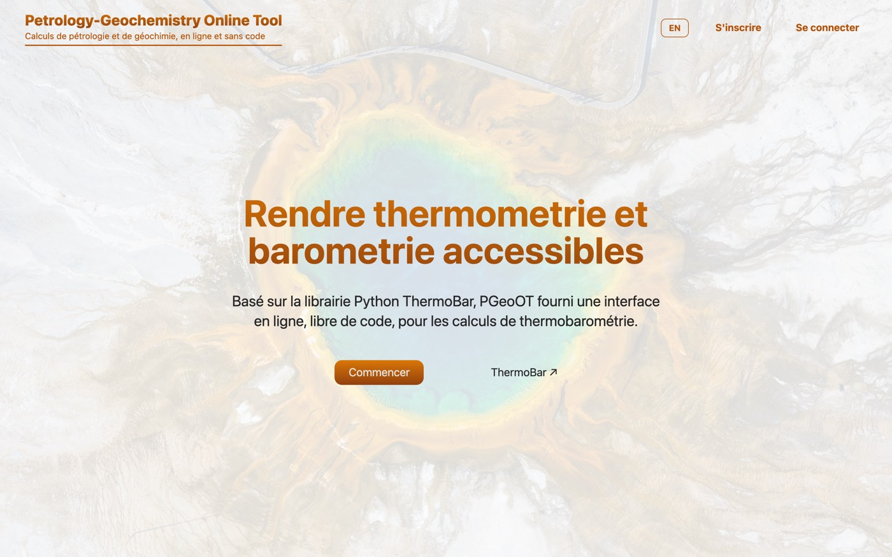
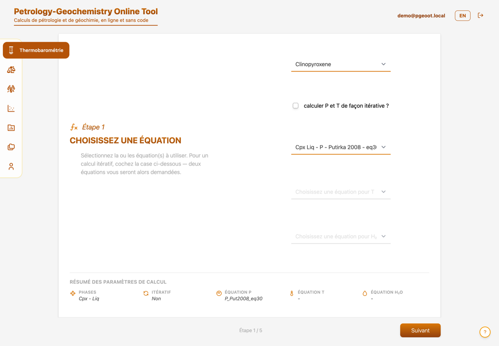
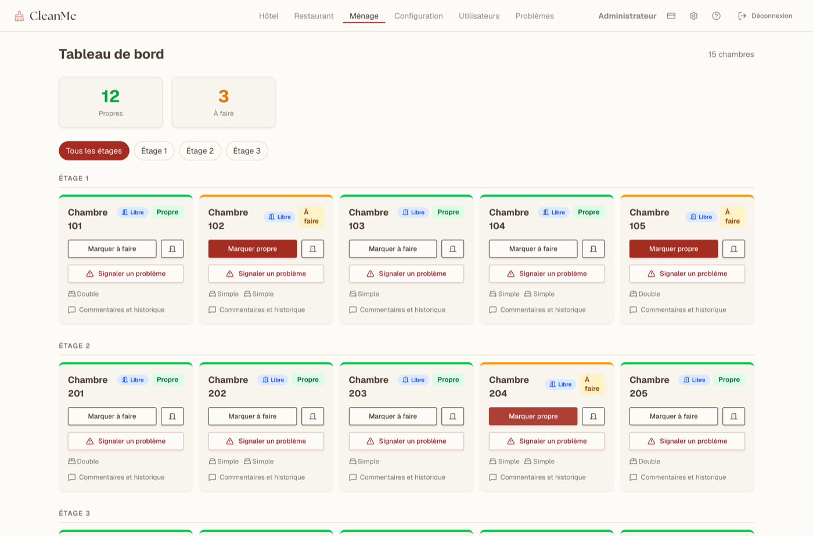
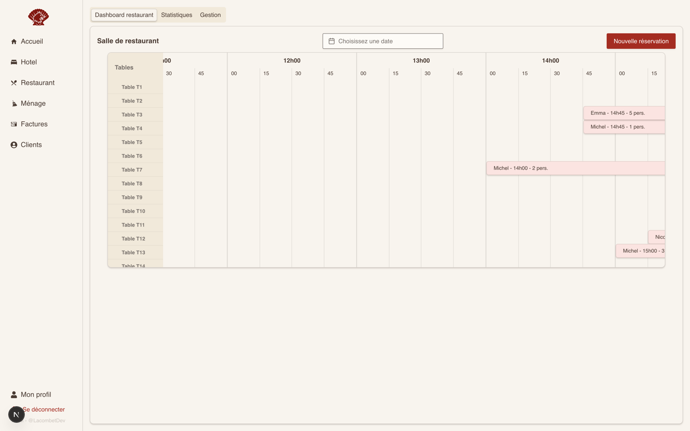

# Tristan Lacombe

**Développeur Full-Stack · Docteur en Sciences de la Terre**

Je conçois des applications web qui rendent exploitables des données scientifiques et
géographiques — du modèle de données jusqu'à l'interface, en passant par les tests et le déploiement.

Actuellement **développeur full-stack & testeur logiciel en alternance chez MSInsight** (dispositif
médical de diagnostic in vitro, ISO 13485 / IEC 62304). Je recherche un poste à l'interface
**logiciel · données · géosciences**, en agglomération lyonnaise.

---

## Ce que je fais

- **Des applications métier complètes** — authentification, rôles et permissions, migrations de
  base, API documentées, interfaces réactives. Pas de prototype jetable : des produits qui tournent.
- **Du calcul scientifique derrière une interface utilisable** — j'enveloppe des bibliothèques Python
  de pétrologie et de géochimie dans des services web, pour que des géologues les utilisent sans
  écrire une ligne de code.
- **Des tests et une chaîne CI/CD** — tests unitaires, d'intégration et end-to-end, lint, typecheck
  et audits de sécurité bloquants avant chaque déploiement.
- **De l'hébergement que j'administre moi-même** — VPS Linux, Docker Compose, Nginx, runners
  GitHub Actions auto-hébergés, durcissement SSH.

---

## Stack

| | |
|---|---|
| **Front** | TypeScript · React · Next.js · Angular · React Native · Vite · Tailwind CSS |
| **Back** | NestJS · FastAPI · Express · TypeORM · Drizzle ORM · PostgreSQL · API REST, Swagger/OpenAPI |
| **Qualité** | Jest · Supertest · Vitest · Cypress · pytest · ESLint, Prettier, Husky · CI/CD GitHub Actions |
| **Infra** | Docker & Docker Compose · Linux · Nginx · AWS · Git |
| **Données & SIG** | Python (pandas, NumPy, scikit-learn) · QGIS · Mapbox · Turf.js · D3.js · Observable · Plotly |
| **Méthodes** | Agile / Scrum · développement assisté par IA (Claude Code) · environnement réglementé (ISO 13485, IEC 62304) |

---

## Projets

### Petro-Geoch Online Tool (PGeoOT) · privé

Plateforme web modulaire de pétrologie et de géochimie. Le premier module expose la bibliothèque
scientifique Python [Thermobar](https://github.com/PennyWieser/Thermobar) (thermobarométrie,
hygrométrie) derrière une interface sans code : import de données, calcul de la norme CIPW,
formules structurales, graphiques interactifs, export Excel. Inscription sur code d'invitation,
administration des comptes.

**Monorepo Turborepo / npm workspaces, trois applications :**
- `web` — React, Vite, Tailwind, TanStack Query, Plotly, ExcelJS
- `api` — NestJS, TypeORM, PostgreSQL, JWT/Passport, Helmet, rate limiting, migrations versionnées
- `calc-svc` — Python 3.12, FastAPI, Thermobar, pyrolite, NumPy/pandas (géré avec `uv`)

**Ce dont je suis le plus satisfait :** la CI exécute lint, typecheck, tests Node, ruff et pytest,
plus `audit-ci` et `pip-audit` en barrières bloquantes ; le déploiement est déclenché par tag sur un
runner auto-hébergé et ne part qu'avec une CI verte. Le dépôt documente un audit de sécurité et un
audit RGPD.

  

  

### Wash-Me · privé

> Dépôt `CleanMe` — l'interface porte encore ce nom sur les captures.

Application de gestion hôtelière : suivi du ménage des chambres, affectation du personnel,
réservations au restaurant, gestion multi-agences, parcours de paiement Stripe.

**Stack :** NestJS, TypeORM, PostgreSQL, Swagger, Stripe · React, Vite, Tailwind, Radix UI, Zustand,
TanStack Query, PWA · monorepo npm workspaces, Docker Compose, déploiement sur VPS par SSH.
Tests Jest + Supertest côté API (unitaires, contrôleurs, e2e) et Vitest côté interface.
Documentation technique : diagramme de classes, modèle de données, architecture de déploiement,
plans de test.

  

### Hotel & Restaurant Manager (HRM) · privé

Gestion complète d'un hôtel-restaurant : chambres et typologies, réservations, arrivées et départs,
petits-déjeuners, état des chambres en temps réel, plan de salle et timeline du restaurant,
employés et rôles, statistiques.

**Stack :** Next.js (App Router), React, TypeScript, Drizzle ORM + PostgreSQL, better-auth, Jotai,
TanStack Query & Table, react-hook-form + Zod, Tailwind + Radix UI. Docker, déploiement en staging
sur VPS.

  

### [Unofficial GERM API](https://github.com/LacombeTr/volcapi) · public

API REST qui expose au format JSON les données du **GERM** (Geochemical Earth Reference Model),
jusqu'ici disponibles uniquement sous forme de tableaux HTML — pour les rendre exploitables par
des applications web et des scripts d'analyse.

**Stack :** TypeScript, Express, Drizzle ORM, PostgreSQL, collecte avec Cheerio, documentation
Swagger, tests Jest, conteneurisation Docker.

---

## Parcours & publications

**Docteur en Sciences de la Terre** (Université Clermont Auvergne, 2020–2023) — Laboratoire Magmas
et Volcans. Thèse : *Volcanisme basaltique et phonolitique de Petite-Terre (Mayotte)*, en
collaboration avec l'IPGP, l'Université Lyon 1 et l'OVSG. Quatre campagnes de terrain à Mayotte,
cartographie géomorphologique sous QGIS, plus de 500 échantillons analysés à la microsonde
électronique, traitement des données en Python.

**Développeur Full-Stack — niveau 6** (IT-Akademy, Lyon, 2024–2026, en alternance).

Publications à comité de lecture :

- Lacombe T., Gurioli L., Di Muro A., Médard E., *et al.* (2024) — Late Quaternary explosive
  phonolitic volcanism of Petite-Terre (Mayotte, Western Indian Ocean). *Bulletin of Volcanology*.
  [10.1007/s00445-023-01697-2](https://doi.org/10.1007/s00445-023-01697-2)
- Michaud-Dubuy A., Komorowski J.-C., Lacombe T., Gurioli L. (2024) — Tephra fallout hazard
  assessment for a hydrovolcanic eruptive scenario in Mayotte. *Scientific Reports*.
  [10.1038/s41598-024-83266-x](https://doi.org/10.1038/s41598-024-83266-x)
- Thivet S., Hess K.-U., Dingwell D. B., *et al.*, Lacombe T., Komorowski J.-C. (2023) — Volatiles
  of the active Mayotte volcanic chain: STA & EGA-MS analysis of volcanic products.
  *Chemical Geology*. [10.1016/j.chemgeo.2022.121297](https://doi.org/10.1016/j.chemgeo.2022.121297)

---

## Contact

- **LinkedIn** — [tristan-lacombe](https://www.linkedin.com/in/tristan-lacombe-734168139/)
- **Portfolio** — [lacombet.fr](https://lacombet.fr)
- **Email** — tlacombevulca@outlook.fr

Le code des projets privés peut être présenté sur demande, démonstration à l'appui.

---

<b>🇬🇧 English version</b>

 

**Full-Stack Developer · PhD in Earth Sciences**

I build web applications that make scientific and geospatial data usable — from the data model to
the interface, including tests and deployment.

Currently a **full-stack developer & software tester apprentice at MSInsight** (in-vitro diagnostic
medical device, ISO 13485 / IEC 62304). I am looking for a role at the intersection of
**software, data and geosciences**, in the Lyon area.

### What I do

- **Complete business applications** — authentication, roles and permissions, database migrations,
  documented APIs, reactive interfaces. Not throwaway prototypes: products that actually run.
- **Scientific computing behind a usable interface** — I wrap Python petrology and geochemistry
  libraries in web services so geologists can use them without writing a line of code.
- **Tests and a real CI/CD pipeline** — unit, integration and end-to-end tests, linting, type
  checking and blocking security audits before every deployment.
- **Infrastructure I run myself** — Linux VPS, Docker Compose, Nginx, self-hosted GitHub Actions
  runners, SSH hardening.

### Stack

| | |
|---|---|
| **Front** | TypeScript · React · Next.js · Angular · React Native · Vite · Tailwind CSS |
| **Back** | NestJS · FastAPI · Express · TypeORM · Drizzle ORM · PostgreSQL · REST APIs, Swagger/OpenAPI |
| **Quality** | Jest · Supertest · Vitest · Cypress · pytest · ESLint, Prettier, Husky · GitHub Actions CI/CD |
| **Infra** | Docker & Docker Compose · Linux · Nginx · AWS · Git |
| **Data & GIS** | Python (pandas, NumPy, scikit-learn) · QGIS · Mapbox · Turf.js · D3.js · Observable · Plotly |
| **Practices** | Agile / Scrum · AI-assisted development (Claude Code) · regulated environments (ISO 13485, IEC 62304) |

### Projects

**Petro-Geoch Online Tool (PGeoOT)** · private — Modular web platform for petrology and
geochemistry. Its first module exposes the Python library
[Thermobar](https://github.com/PennyWieser/Thermobar) (thermobarometry, hygrometry) through a
no-code interface: data import, CIPW norm, structural formulae, interactive charts, Excel export.
Turborepo monorepo with three apps — React/Vite/Tailwind front end, NestJS + TypeORM + PostgreSQL
API, and a Python 3.12 FastAPI calculation service. CI runs lint, type checking, Node tests, ruff
and pytest, plus `audit-ci` and `pip-audit` as blocking gates; tag-triggered deployment to a
self-hosted runner. The repository documents a security audit and a GDPR audit.

**Wash-Me** · private — Hotel management app: housekeeping tracking, staff assignment, restaurant
bookings, multi-agency support, Stripe payment flow. NestJS + TypeORM + PostgreSQL + Swagger +
Stripe; React + Vite + Tailwind + Radix UI + Zustand + PWA. Jest/Supertest API tests (unit,
controller, e2e) and Vitest on the front end. Docker Compose, SSH deployment to a VPS.

**Hotel & Restaurant Manager (HRM)** · private — Full hotel and restaurant management: rooms and
room types, bookings, arrivals and departures, breakfasts, live room status, restaurant floor plan
and timeline, employees and roles, statistics. Next.js App Router, React, Drizzle ORM + PostgreSQL,
better-auth, Jotai, TanStack Query & Table, react-hook-form + Zod.

**[Unofficial GERM API](https://github.com/LacombeTr/volcapi)** · public — REST API serving the
**GERM** (Geochemical Earth Reference Model) dataset as JSON — previously available only as HTML
tables — so web apps and analysis scripts can consume it. TypeScript, Express, Drizzle ORM,
PostgreSQL, Cheerio ingestion, Swagger docs, Jest tests, Docker.

### Background & publications

**PhD in Earth Sciences** (Université Clermont Auvergne, 2020–2023) — Laboratoire Magmas et Volcans.
Thesis: *Basaltic and phonolitic volcanism of Petite-Terre (Mayotte)*, in collaboration with IPGP,
Université Lyon 1 and OVSG. Four field campaigns in Mayotte, geomorphological mapping in QGIS, over
500 samples analysed by electron microprobe, data processing in Python.

**Full-Stack Developer — EQF level 6** (IT-Akademy, Lyon, 2024–2026, apprenticeship).

Peer-reviewed publications:

- Lacombe T., Gurioli L., Di Muro A., Médard E., *et al.* (2024) — Late Quaternary explosive
  phonolitic volcanism of Petite-Terre (Mayotte, Western Indian Ocean). *Bulletin of Volcanology*.
  [10.1007/s00445-023-01697-2](https://doi.org/10.1007/s00445-023-01697-2)
- Michaud-Dubuy A., Komorowski J.-C., Lacombe T., Gurioli L. (2024) — Tephra fallout hazard
  assessment for a hydrovolcanic eruptive scenario in Mayotte. *Scientific Reports*.
  [10.1038/s41598-024-83266-x](https://doi.org/10.1038/s41598-024-83266-x)
- Thivet S., Hess K.-U., Dingwell D. B., *et al.*, Lacombe T., Komorowski J.-C. (2023) — Volatiles
  of the active Mayotte volcanic chain: STA & EGA-MS analysis of volcanic products.
  *Chemical Geology*. [10.1016/j.chemgeo.2022.121297](https://doi.org/10.1016/j.chemgeo.2022.121297)

### Contact

- **LinkedIn** — [tristan-lacombe](https://www.linkedin.com/in/tristan-lacombe-734168139/)
- **Portfolio** — [lacombet.fr](https://lacombet.fr)
- **Email** — tlacombevulca@outlook.fr

Code for the private projects can be walked through on request, with a live demo.

